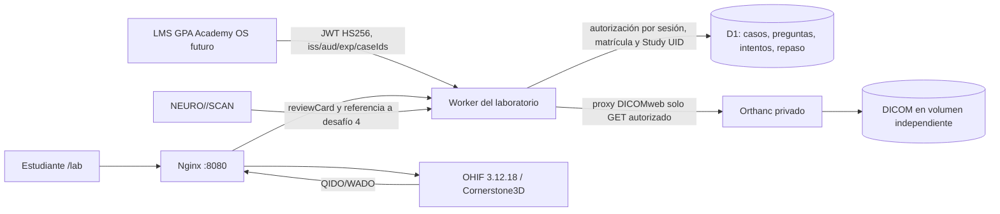

# GPA Medical Imaging Lab — MVP local

Laboratorio educativo independiente de GPA Academy OS. La rama base contiene NEURO//SCAN, pero no la aplicación principal. Se inspeccionó también `/Users/lestertavarez/gpa-academy-os`: su Next.js 14 usa estudiantes y matrículas simulados; no ofrece una sesión académica verificable para enlazar sin inventar integración. Por eso este módulo expone un contrato LMS firmado y conserva NEURO//SCAN sin cambios.

**Solo enseñanza.** La serie incluida es DICOM sintético de 16 cortes con arte geométrico; no reproduce anatomía clínica ni sirve para diagnóstico. No cargue estudios reales sin autorización y revisión de desidentificación, incluida inspección de píxeles.

## Arquitectura



OHIF proporciona navegación de series y cortes, zoom, pan, Window/Level, presets, mediciones y herramientas de orientación. Las herramientas MPR dependen de que el estudio y el modo OHIF lo permitan. La reconstrucción volumétrica, ROI gráfico y anotaciones persistentes dentro del visor quedan para la fase siguiente. El panel GPA contiene pistas, preguntas y progreso; no implementa un segundo visor.

### Esquema y adaptador educativo

`cases.adapter_version=1` relaciona un caso académico con `study_uid`, `annotations` y `neuroscan_challenge_id`, sin cambiar el JSON ni el estado de NEURO//SCAN. La pregunta de demostración adapta el desafío 4. El Worker importa `reviewCard` desde `neuroscan/src/core/srs.js` para calcular el repaso espaciado. D1 guarda solo metadatos, matrícula, intentos y tarjetas de repaso; los píxeles residen en Orthanc. Los tres modos son `GUIDED` (objetivos, etiquetas y explicación), `PRACTICE` (respuesta y feedback), y `EVALUATION` (sin pistas durante la pregunta; calificación al enviar).

## Inicio local

Requisitos: Node 22.22.2 LTS, 24.15 LTS o 26+ (Node 25 emite advertencias de compatibilidad), npm, Docker Desktop/Engine, Python 3.10+. Para regenerar los DICOM: `pip install pydicom==3.0.1` y `python3 scripts/generate_demo.py`. Los 16 archivos ya están versionados.

```bash
cd medical-imaging-lab
cp .env.example .env
cp .dev.vars.example .dev.vars
# Use el MISMO ORTHANC_PASSWORD en ambos archivos; cambie todas las claves de ejemplo.
npm ci
npm run db:migrate:local
npm run build
npm run dev                 # Worker + D1 en :8788; deje esta terminal abierta
# En otra terminal:
docker compose up -d --quiet-pull
set -a; . ./.env; set +a
npm run seed:dicom
# Abra http://127.0.0.1:8080/lab/
```

Introduzca `DEMO_ACCESS_KEY` de `.dev.vars`. La muestra solo está activa con `DEMO_MODE=true`. Para detener servicios: `docker compose down`; no use `-v` si desea conservar los estudios. La interfaz OHIF y el gateway comparten origen en `:8080`; Orthanc solo se expone en `127.0.0.1:8042` con Basic Auth y no se publica por Nginx. Para revisar la API sin Docker se puede usar `http://127.0.0.1:8788`, aunque no cargarán las imágenes.

### Integración futura con GPA Academy OS

El dashboard puede enlazar a `/lab/`, pero el enlace por sí solo no concede acceso. El servidor LMS debe crear un JWT HS256 con `sub` (ID académico opaco), `iss=gpa-academy-os`, `aud=gpa-imaging-lab`, `exp` (máximo 1 hora desde emisión), y `caseIds` matriculados. Lo envía al backend mediante `POST /api/lab/auth/exchange` con `Authorization: Bearer <JWT>`. El Worker verifica firma, emisor, audiencia y expiración; registra esas matrículas y entrega cookie `HttpOnly`, `SameSite=Lax` de 30 minutos. El secreto `LMS_SHARED_SECRET` se comparte solo entre servidores. Para producción se recomienda un proveedor OIDC/JWKS y una sincronización de bajas de matrícula. No se usa un parámetro URL como prueba de acceso. `SESSION_SECRET` es independiente del secreto LMS. Configure HTTPS para activar `Secure` en la cookie.

El contrato versionado de casos es `adapter_version=1`; un LMS puede mapear cada `caseId` a su curso. La migración del progreso de NEURO//SCAN no se hace automáticamente.

## API

Todas las rutas de estudiante requieren cookie válida, salvo `health`, `auth/demo` y `auth/exchange`.

| Ruta | Método | Propósito |
|---|---|---|
| `/api/lab/auth/demo` | POST | Acceso local con `{key}` si `DEMO_MODE=true` |
| `/api/lab/auth/exchange` | POST | Intercambio de JWT LMS firmado |
| `/api/lab/auth/logout` | POST | Cerrar cookie |
| `/api/lab/cases` | GET | Casos publicados y matriculados |
| `/api/lab/cases/:id` | GET | Caso, objetivos y preguntas sin respuestas |
| `/api/lab/attempts` | POST | `{caseId,questionId,mode,selected}`; respuesta, nota y repaso |
| `/api/lab/progress` | GET | Historial agregado y tarjetas de repaso |
| `/dicomweb/studies?StudyInstanceUID=...` | GET | QIDO solo para UID matriculado |
| `/dicomweb/studies/:uid/...` | GET | WADO solo para UID matriculado |
| `/api/lab/admin/cases` | GET/POST | Listar y crear casos, Bearer `ADMIN_KEY` |
| `/api/lab/admin/cases/:id/status` | PUT | Publicar/despublicar, Bearer `ADMIN_KEY` |
| `/api/lab/admin/questions` | POST | Crear pregunta, Bearer `ADMIN_KEY` |
| `/api/lab/admin/stats` | GET | Rendimiento agregado, Bearer `ADMIN_KEY` |

La interfaz administrativa está en `/lab/admin` y solicita `ADMIN_KEY` en memoria de la pestaña; permite crear borradores, añadir preguntas, publicar/despublicar y consultar estadísticas. Ejemplo de pregunta administrativa: `{"id":"GPA-Q-002","caseId":"GPA-NEURO-001","kind":"multiple_choice","prompt":"...","options":["A","B"],"answer":0,"explanation":"...","source":"...","difficulty":"Básica"}`. Las llamadas administrativas usan `Authorization: Bearer <ADMIN_KEY>`; no hay clave incrustada en la web. Los cuerpos están limitados a 16 KB y se validan IDs, UID, estado, opciones e índice correcto. El proxy rechaza escrituras DICOMweb y búsquedas globales. El Worker aplica rate limit a autenticación y administración. La app sirve CSP que solo permite recursos del mismo origen.

## Pruebas

```bash
npm run check                    # ESLint, typecheck, Vitest, build
npx playwright install chromium  # primera ejecución
npm run test:e2e                 # requiere Orthanc, OHIF/gateway y 16 DICOM importados
cd ../neuroscan && npm run check # regresión de la aplicación original
cd ../neuroscan && npm run test:e2e
```

Las pruebas E2E comprueban denegación anónima, consulta DICOMweb con sesión, carga de OHIF, respuesta y progreso. El archivo `TEST-REPORT.md` registra resultados reales de esta ejecución. [Captura del prototipo](docs/prototype.png).

## Despliegue posterior

No hay despliegue productivo. Para una instalación real: crear D1 remoto y cambiar `database_id`, cargar secretos en Cloudflare, poner Orthanc en red privada alcanzable desde el Worker (Cloudflare Tunnel u otro enlace seguro), configurar un gateway HTTPS con las rutas de `nginx/default.conf`, reemplazar la entrada demo por LMS, revisar licencias y atribución de cualquier dataset nuevo, y hacer auditoría clínica y de seguridad. El gateway local `host.docker.internal` es para desarrollo, no un endpoint de producción. El volumen `orthanc-data` no debe contener datos de pacientes en este MVP.

Fuentes de APIs: [OHIF DICOMweb](https://docs.ohif.org/configuration/datasources/dicom-web/), [parámetros de URL OHIF](https://docs.ohif.org/configuration/url/), [Docker OHIF](https://docs.ohif.org/deployment/docker/), [Orthanc DICOMweb](https://orthanc.uclouvain.be/book/plugins/dicomweb.html), [Orthanc Team Docker](https://orthanc.uclouvain.be/book/users/docker-orthancteam.html).

### Alternativa local ante bloqueo de arranque de Docker Desktop

En esta estación Docker Desktop pudo ejecutar Orthanc pero dejó bloqueado el arranque de los contenedores OHIF/Nginx. El mismo bundle oficial de OHIF se puede servir con el gateway Node incluido, sin recompilar ni duplicar el visor:

```bash
# Con Docker funcionando lo suficiente para descargar/exportar la imagen:
python3 scripts/extract_ohif.py
# Inicie solo Orthanc (nombre creado por Compose) y el Worker:
docker compose up -d orthanc
set -a; . ./.env; set +a; npm run seed:dicom
npm run dev
# En otra terminal, desde medical-imaging-lab:
node scripts/local_gateway.mjs
# Abra http://127.0.0.1:8080/lab/
```

El gateway Node es solo para desarrollo y entrega los archivos estáticos de `ohif/app:v3.12.18`; no se despliega. La ruta estándar sigue siendo `docker compose up -d`. Si Docker Desktop no puede arrancar Orthanc, debe recuperarse su daemon o usarse otro servidor Orthanc DICOMweb protegido con el mismo contrato.
